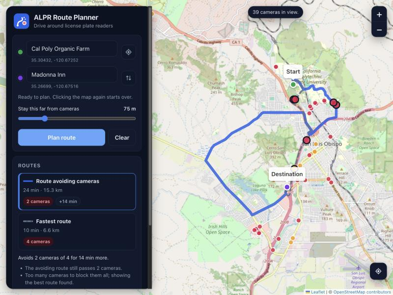
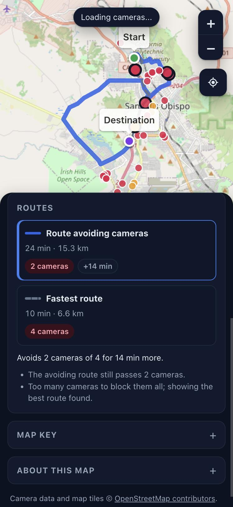

# ALPR Route Planner

See automated license plate reader (ALPR) cameras, primarily Flock Safety cameras, on a map,
and plan a driving route that avoids them next to the normal fastest route.

 

- **Search or click** to set the start and destination, or use your current location.
- **Two routes, compared:** the fastest one, and one that steers around mapped cameras, with the
  camera count and extra time for each.
- **Adjustable distance:** choose how close to a camera counts as passing it (15 to 300 m).
- **Works when the data service is slow:** camera tiles are cached on disk (or on the phone), so
  areas seen before load at once and still show when Overpass is down. Public Overpass mirrors
  are tried in turn.
- **Web and Android:** the same code answers requests in the Node server and inside the Android
  app, so the phone app needs no server.

Built by [Roughcut](https://github.com/fellobello/roughcut) from a one-line idea, then polished
into this release. `.hub/` holds the original plan and decisions.

## Run

Needs Node.js 22 or newer. There are no npm dependencies.

    npm start          # live data: OpenStreetMap cameras (Overpass), Valhalla routes, Nominatim search
    npm run offline    # no network: made-up sample cameras and a straight-line stub router

Then open http://127.0.0.1:8080.

| Variable        | Default                              | Meaning                                              |
| --------------- | ------------------------------------ | ---------------------------------------------------- |
| `PORT`, `HOST`  | `8080`, `127.0.0.1`                  | Where the server listens                             |
| `CONTACT`       | none                                 | Email or URL in the User-Agent, as the OSM services ask |
| `CACHE_FILE`    | `data/cache/overpass-tiles.json`     | Saved camera tiles; `off` keeps them in memory only  |
| `GEOCODER`      | `nominatim`                          | `none` turns search off (typed "lat, lon" still works) |
| `OFFLINE`       | off                                  | `1` uses the sample cameras and stub router          |

### Docker

    docker build -t alpr-route-planner .
    docker run -p 8080:8080 -v alpr-cache:/app/data/cache -e CONTACT=you@example.com alpr-route-planner

## Android

The Android app is a [Capacitor](https://capacitorjs.com) wrapper in `mobile/`. It bundles the web
app plus the planner, and talks to Overpass, Valhalla and Nominatim directly.

    cd mobile && npm install
    npm run apk            # builds mobile/android/app/build/outputs/apk/debug/app-debug.apk
    npm run install-apk    # installs it on a phone connected with USB debugging (adb)

Building needs JDK 21 and the Android SDK, from Android Studio or the command-line tools:

    brew install --cask android-commandlinetools
    yes | sdkmanager --licenses
    sdkmanager "platform-tools" "platforms;android-36" "build-tools;36.0.0"
    echo "sdk.dir=/opt/homebrew/share/android-commandlinetools" > mobile/android/local.properties
 `npm run open` opens the project in
Android Studio. If the server has cached camera tiles in `data/cache/`, they are bundled as the
app's starter data.

## Test

    npm test

Tests never touch the network: outside services are faked through injected `fetch`.

## Layout

    src/api.js              the API's behavior, shared by the server and the Android app
    src/planner.js          fastest + avoiding route planning
    src/cameras/            camera sources (Overpass with tile cache and mirrors, offline sample)
    src/routing/            routers (Valhalla, offline stub)
    src/geocode/            place search (Nominatim) and typed coordinates
    src/server/             HTTP server
    public/                 browser app (Leaflet, vendored in public/vendor)
    mobile/                 Android app (Capacitor)
    test/                   unit and acceptance tests

## Data and credits

Camera locations, place search and map tiles are © OpenStreetMap contributors, under the Open
Database License. Camera coverage is crowd-sourced and incomplete: a route that avoids every
mapped camera can still pass unmapped ones. Missing cameras can be
[added to OpenStreetMap](https://wiki.openstreetmap.org/wiki/Tag:surveillance:type%3DALPR).

Not affiliated with Flock Safety.
